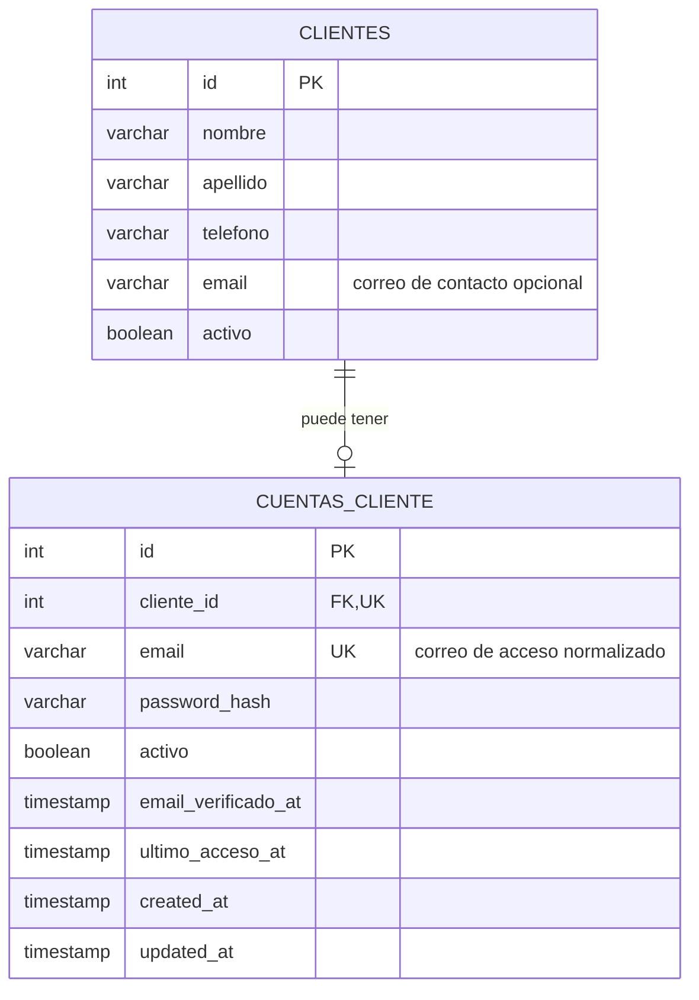

# Modelo de cuenta de cliente

## Decisión

La identidad de negocio (`clientes`) y las credenciales del portal
(`cuentas_cliente`) se modelan como entidades distintas con una relación uno a
uno opcional:

- Un cliente puede existir sin cuenta. Este caso sigue siendo necesario porque
  recepción puede registrar clientes que no utilizan el portal.
- Una cuenta pertenece obligatoriamente a un solo cliente.
- `UNIQUE (cliente_id)` impide que un cliente tenga más de una cuenta.
- El índice único sobre el correo normalizado impide que dos cuentas utilicen
  el mismo identificador de inicio de sesión, incluso con mayúsculas distintas.
- La llave foránea usa `ON DELETE RESTRICT`. Los clientes se desactivan de forma
  lógica y no deben borrarse junto con sus credenciales o su historial.

## Separación respecto a `usuarios`

`usuarios` continúa representando al personal interno: Administrador,
Recepcionista y Operario. Una cuenta de cliente no es un usuario interno ni
necesita una fila artificial en `roles`. Esta separación evita duplicar el
nombre, teléfono y estado del cliente en `usuarios`, y evita que permisos del
panel administrativo se otorguen accidentalmente al portal público.

Cuando se implemente la emisión de JWT para el portal, el token debe identificar
explícitamente el tipo de actor y el cliente, por ejemplo con claims
`actor=cliente` y `cliente_id`. Los tokens actuales de empleados conservan
`usuario_id` y `rol_id`.

## Reglas de seguridad y ciclo de vida

1. La contraseña nunca se persiste en texto plano. `password_hash` recibe el
   resultado de bcrypt y no se serializa en JSON.
2. El correo de acceso se guarda con espacios removidos y en minúsculas. Puede
   ser diferente del correo de contacto existente en `clientes`, evitando que
   un cambio administrativo rompa el inicio de sesión sin confirmación.
3. Para autenticar deben estar activos tanto `clientes.activo` como
   `cuentas_cliente.activo`.
4. `email_verificado_at` nulo significa que el correo todavía no fue
   verificado. `ultimo_acceso_at` permite auditoría sin mezclarla con los datos
   del perfil.
5. Registro, recuperación de contraseña y verificación de correo deberán
   ejecutarse en servicios de autenticación; sus tokens temporales no deben
   guardarse en esta tabla en texto plano.

## Flujo de registro previsto para la landing page

El endpoint público de registro deberá ejecutar una sola transacción:

1. Validar y normalizar los datos del perfil y de acceso.
2. Crear o vincular el registro de `clientes` de acuerdo con la política de
   negocio acordada.
3. Generar el hash bcrypt de la contraseña.
4. Crear `cuentas_cliente` con el `cliente_id` obtenido.
5. Confirmar la transacción únicamente si ambas escrituras fueron exitosas.

Esta tarea define el modelo persistente y su relación. Los endpoints públicos
de registro, login, verificación y recuperación se implementan sobre este
contrato sin exponer las rutas administrativas de `/api/clientes`.
